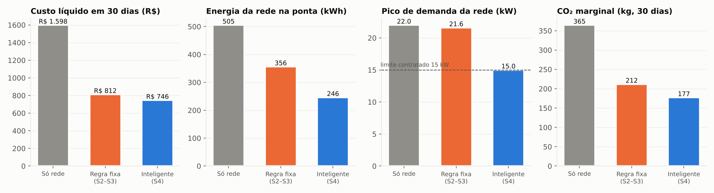
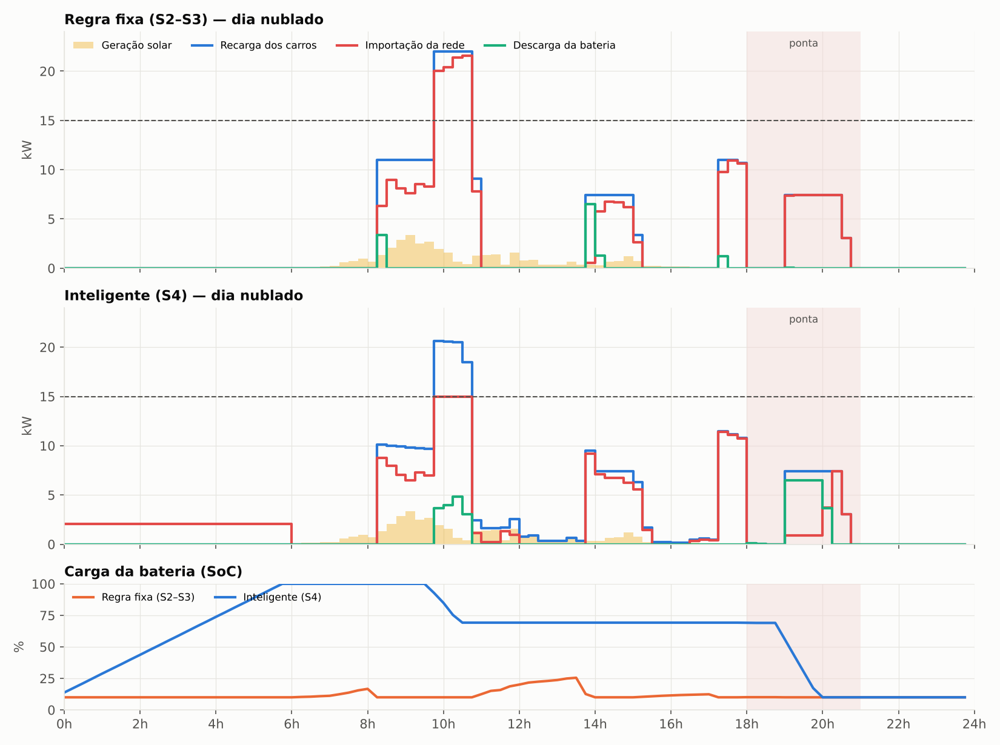
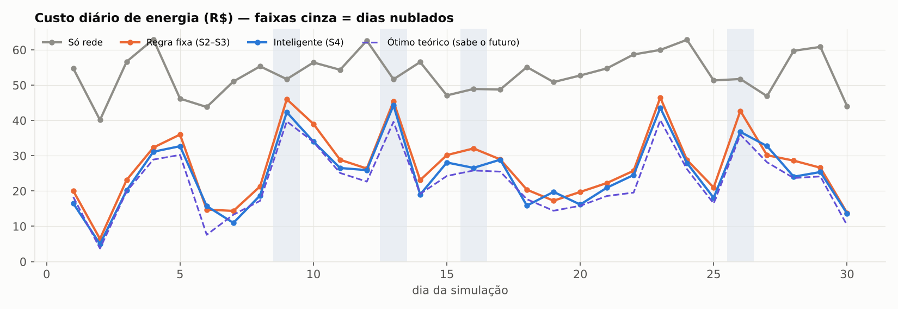

# ⚡ ChargeGrid — Eletroposto Inteligente (EV Challenge 2026)

**Sprint 4 — Solução Final Integrada e Inovadora, em parceria com a GoodWe**

## 👥 Equipe

- Mauricio Bertuci Saletti — RM571229
- Mateus Eduardo da Cruz Rocha — RM570736
- Lucas Caram Bueno — RM570158
- Rhuan Pacheco Carreri — RM570129
- Leonardo Fortini Marcelo — RM572566
- Nicolas Andrade Rodrigues — RM572782

---

## 📌 O que esta sprint entrega, em relação às anteriores

| Sprint | Entrega |
|---|---|
| 1 | Proposta: eletroposto integrado ao ecossistema GoodWe (solar + BESS + gestão de energia) |
| 2 | Prova de conceito: firmware ESP32 (Wokwi) com a regra **SOLAR → BATERIA → REDE** |
| 3 | Integração: a mesma regra orquestrando múltiplas **sessões de recarga** de um dia, com dashboard |
| **4** | **Solução final**: a regra fixa é substituída por um **algoritmo de controle preditivo** que respeita a hora de saída de cada motorista, aprende o padrão de consumo, usa previsão do tempo e nunca ultrapassa a demanda contratada. Testado contra **30 dias simulados** (183 sessões reais), contra a regra das Sprints 2-3, contra "sem sistema" e contra um **ótimo teórico com informação perfeita**. Inclui firmware ESP32 v4 com telemetria MQTT, dashboard interativo e assistente virtual (**Volt**) que responde em linguagem natural usando os mesmos dados. |

A Sprint 3 provou que o sistema entrega energia sessão a sessão. A Sprint 4 prova que ele **decide bem**: não só segue a ordem solar→bateria→rede, mas planeja a recarga de cada carro dentro da sua janela de permanência, guarda bateria para a ponta na medida certa (aprendida, não fixa), e nunca estoura o limite de demanda contratado — o que a regra das sprints anteriores não controlava.

---

## 🏗️ Arquitetura da solução

```
                         ☀️  FV 10 kWp            🔋 Bateria GoodWe
                         (perfil real + previsão)   Lynx Home F — 13,1 kWh
                              │                          │
                              ▼                          ▼
   🚗 Motorista informa  ┌─────────────────────────────────────────────┐
   energia + hora saída  │   ALGORITMO INTELIGENTE (motor/estrategias.py)│
   no app/QR ───────────▶│                                               │
                         │  1. Smart charging por LAXIDADE               │
                         │     (energia mínima garantida + segue o sol)  │
                         │  2. Reserva de ponta APRENDIDA                 │
                         │     (média móvel do consumo 17h–22h)          │
                         │  3. Pré-carga preditiva (previsão do tempo)    │
                         │  4. Peak shaving (nunca > demanda contratada) │
                         └───────────────┬───────────────┬───────────────┘
                                         │               │
                          replica no ──▶ │               │ ◀── mesma lógica
                          ESP32 (Wokwi)  │               │     no Python (30 dias)
                                         ▼               ▼
                              📡 MQTT (telemetria)   📊 dados/resultados.json
                                         │               │
                                         ▼               ▼
                         🖥️ dashboard/index.html  ◀───────┘
                            (resultados · perfil do dia · ao vivo · sessões)
                                         │
                                         ▼
                              🤖 Assistente virtual "Volt"
                           (mesmo motor de intenções em Python e em JS)
```

**Camadas e como se conectam**

1. **Geração e armazenamento** — inversor híbrido e BESS GoodWe (ver seção de equipamentos). A geração real é simulada com nuvens passageiras (ruído autocorrelacionado); a previsão de amanhã é simulada com erro, exatamente como uma previsão de tempo real (e há uma função pronta que troca a simulação pela irradiância real da API Open-Meteo).
2. **Demanda** — 3 perfis de motorista (expediente, visita curta, recarga noturna), com chegada, saída e energia desejada — não só "carrega na potência máxima" como nas sprints anteriores.
3. **Controle** — `motor/estrategias.py` implementa as 4 estratégias comparadas (ver abaixo) e um motor físico comum, que todas respeitam (limites de potência do carregador/bateria, eficiência de carga/descarga, SoC mínimo).
4. **Réplica em hardware** — `firmware/eletroposto_v4.ino` roda o mesmo algoritmo em C++ num ESP32 simulado no Wokwi, publicando telemetria por MQTT e aceitando comandos remotos (modo, limite de demanda, reserva, previsão).
5. **Exibição e interação** — `dashboard/index.html` consome os mesmos dados (`dados/resultados.json`) e, ao vivo, o tópico MQTT do ESP32; o assistente **Volt** responde perguntas reaproveitando o texto do `assistente/assistente.py`.

---

## 🧠 As quatro estratégias comparadas (`motor/estrategias.py`)

| Estratégia | O que faz |
|---|---|
| **Sem sistema** | Recarrega 100% da rede, sem solar nem bateria — linha de base. |
| **Regra fixa (Sprints 2-3)** | Carrega cada carro na potência máxima assim que ele chega; usa SOLAR → BATERIA → REDE, sem olhar para a janela de tempo disponível nem para o limite de demanda. |
| **Inteligente (Sprint 4)** | Smart charging por laxidade (carrega o mínimo necessário agora, usa a folga da janela para seguir o sol e fugir da ponta), reserva de bateria aprendida, pré-carga preditiva em dias nublados, e peak shaving — **nunca** importa mais que a demanda contratada. |
| **Ótimo teórico** | Programação linear (`scipy.optimize.linprog`) que conhece o sol real e todas as sessões do dia *antes* de decidir — impossível na prática, serve apenas de régua para medir quão perto do ideal o algoritmo inteligente chega. |

---

## 📊 Resultados — 30 dias simulados, 183 sessões de recarga reais

*(17 dias ensolarados, 9 parcialmente nublados, 4 nublados/chuvosos — gerados com variação estocástica, não hardcoded)*



| Indicador | Sem sistema | Regra fixa (S2–S3) | **Inteligente (S4)** |
|---|---:|---:|---:|
| Energia entregue (kWh) | 2.130 | 2.130 | **2.130** |
| % renovável na recarga | 0,0% | 50,7% | **52,3%** |
| Energia da rede (kWh) | 2.130 | 1.049 | **1.032** |
| Energia da rede na ponta (kWh) | 505 | 356 | **246** |
| Pico de demanda (kW) | 22,0 | 21,6 | **15,0** |
| Dias acima do limite contratado (15 kW) | 25 | 15 | **0** |
| Custo líquido (R$) | 1.598,43 | 811,74 | **745,87** |
| CO₂ (fator médio SIN, kg) | 82,0 | 40,4 | **39,7** |
| CO₂ marginal (kg, despacho de ponta) | 365 | 212 | **177** |
| Energia não entregue (kWh) | 0 | 0 | **0** |

> **O número mais importante da tabela não é o custo.** É "dias acima do limite": a regra fixa das Sprints 2-3 estourou a demanda contratada em **15 dos 30 dias** — em uma instalação real isso significa multa da concessionária ou disjuntor geral desarmando. O algoritmo inteligente nunca estourou, em nenhum dos 30 dias, porque o peak shaving é parte do controle, não um ajuste manual.

**Quão perto do ótimo teórico (que sabe o futuro) o algoritmo chega:** o custo do inteligente captura **93,4%** da economia máxima possível (ótimo teórico: R$ 685,89; inteligente: R$ 745,87; sem sistema: R$ 1.598,43) — mesmo sem conhecer o futuro, só com previsão imperfeita e aprendizado incremental.

**Honestidade em dia nublado (dia 9, o mais nublado da simulação, 0,40 do índice de claridade):**



| | Sem sistema | Regra fixa | Inteligente |
|---|---:|---:|---:|
| Custo (R$) | 51,69 | 46,01 | **42,32** |
| Rede na ponta (kWh) | 11,86 | 11,85 | **4,44** |
| Pico de demanda (kW) | 22,0 | 21,6 | **15,0** |
| % renovável | 0% | 13,1% | **13,7%** |

Mesmo com pouco sol (9,6 kWh gerados no dia, contra ~55 kWh num dia ensolarado), o sistema ainda reduz a rede na ponta em 63% frente à regra fixa, porque **pré-carregou a bateria de madrugada** usando tarifa fora de ponta, antecipando (pela previsão do tempo) que o dia seria fraco. O mesmo perfil, só que no dia mais ensolarado do mês, está em `docs/img/perfil_dia_ensolarado.png`.



**Por perfil de motorista** (30 dias, estratégia inteligente vs. regra fixa, custo de energia):

| Perfil | Sessões | Energia (kWh) | Custo inteligente | Custo regra fixa |
|---|---:|---:|---:|---:|
| Expediente (fica o dia todo) | 30 | 782 | **R$ 120,24** | R$ 232,78 |
| Visita curta (1–3h) | 123 | 1.016 | **R$ 435,48** | R$ 339,25 |
| Recarga noturna (chega na ponta) | 30 | 332 | **R$ 312,02** | R$ 278,25 |

O ganho é maior em quem fica o dia todo (o carro "de expediente" tem a janela mais longa para o algoritmo escolher os horários de sol) — exatamente o comportamento esperado de um smart charging por laxidade. Visitas curtas e recargas noturnas têm pouca ou nenhuma folga de horário, então o ganho vem principalmente da reserva de bateria, não do reagendamento.

---

## ♻️ Conexão com energias renováveis e sustentabilidade

- A prioridade solar → bateria → rede (herdada das Sprints 1-2) continua sendo a espinha dorsal, mas agora decide **quando** usar cada fonte dentro da janela de cada sessão, não apenas qual fonte usar neste instante.
- **CO₂ com dois fatores, de propósito:** usamos o fator médio oficial do SIN (0,0385 kgCO₂/kWh, MCTI, 2023) para a emissão "contábil", e um fator marginal ilustrativo mais alto na ponta (0,40 kg/kWh, quando termelétricas a gás costumam ser despachadas) para medir o impacto real de tirar carga do horário de pico — é esse segundo número que cai mais (−52% frente a sem sistema, −16,5% frente à regra fixa), porque é o que o peak shaving realmente evita.
- **Impacto mensurável:** os 2.130 kWh/mês entregues equivalem a ~13.310 km rodados em elétrico, evitando ~1.690 kg de CO₂/mês frente a um carro a combustão equivalente (dado ilustrativo, parametrizável em `motor/config.py`).
- **Honestidade nos limites:** no dia mais nublado do mês, o sistema ainda depende de 86% de rede — o dashboard e o assistente mostram esse número sem maquiagem, assim como a Sprint 3 já fazia.

---

## 🔍 Avaliação crítica dos benefícios (o que o algoritmo entrega e o que não entrega)

**Benefícios reais, medidos contra a régua do ótimo teórico (não só contra "antes era pior"):**
- Elimina um risco operacional que a regra fixa das Sprints 2-3 tinha e escondia: estourar a demanda contratada. Isso não aparecia nas sprints anteriores porque elas nunca testaram contra um limite de potência explícito.
- Captura 93,4% da economia de um controlador que conhece o futuro — ou seja, a distância até o ideal teórico é pequena, e o que falta (6,6%) é majoritariamente o custo de não saber o clima de amanhã com exatidão, não uma falha de lógica do algoritmo.
- O ganho de sustentabilidade é maior exatamente onde mais importa: o fator de CO₂ marginal (ponta) cai mais que o fator médio, porque o sistema foi desenhado para evitar rede na ponta, não só "usar menos rede".

**Limitações que a solução não resolve, por serem estruturais e não de implementação:**
- Em dias muito nublados seguidos (não testado nesta simulação — os dias nublados são isolados), a pré-carga preditiva perde eficácia porque a bateria de 13,1 kWh não tem reserva para compensar dois ou três dias sem sol; isso exigiria capacidade de armazenamento maior, não um algoritmo melhor.
- O payback financeiro (10,1 anos só com economia de energia) é alto para um investimento isolado — só fica atrativo (2,6 anos) se o eletroposto cobrar dos motoristas, o que é uma decisão de negócio, não uma otimização técnica.
- Os valores de tarifa, CAPEX e preço de revenda são ilustrativos (declarados como tal desde a Sprint 2); a viabilidade real depende da tarifa contratada e do regime de compensação de energia vigentes na concessionária local.
- O algoritmo pressupõe que o motorista informe a hora de saída; sem essa informação (ou se o motorista a disser errado), a laxidade não pode ser calculada e o sistema cai para o comportamento mais conservador (carrega o mínimo e empurra pro fim da janela), ainda seguro mas menos otimizado.

---

## 🔌 Equipamentos GoodWe e justificativa técnica

| Equipamento | Papel no sistema | Por que esse modelo |
|---|---|---|
| **Inversor híbrido GoodWe GW10K-ET** (10 kW, trifásico) | Converte a energia FV, gerencia carga/descarga da bateria e faz a interface com a rede (on-grid com backup) | Linha ET é o inversor híbrido de referência da GoodWe para autoconsumo residencial/comercial com BESS acoplado em CC, reduzindo perdas de conversão |
| **Bateria GoodWe Lynx Home F** — 4 módulos, 13,1 kWh (química LFP, alta tensão) | Armazena o excedente solar e cobre a ponta | Módulos empilháveis permitem dimensionar a capacidade pela demanda noturna real do eletroposto; química LFP é mais segura e tem mais ciclos de vida que NMC, importante numa aplicação com ciclo diário intenso |
| **2× GoodWe GW11K-HCA (carregador AC, série HCA, 11 kW)** | Recarrega os veículos | Série HCA da GoodWe integra nativamente com o SEMS+ (mesma plataforma do inversor), permitindo coordenar carregador + inversor + bateria num único painel, com *smart phase switching* para priorizar excedente solar |
| **SEMS+ (plataforma GoodWe) + controlador ESP32** | Telemetria, agendamento e visualização | O SEMS+ é a camada de monitoramento comercial da GoodWe; o ESP32 do grupo representa o controlador de borda que, na integração real, trocaria dados com o SEMS+ via API/MQTT — por isso o firmware já fala MQTT, protocolo amplamente usado em integrações IoT com esse tipo de plataforma |

Fontes consultadas: páginas oficiais de produto GoodWe HCA G2 ([en.goodwe.com/hca-g2](https://en.goodwe.com/hca-g2)) e linha de baterias Lynx Home F ([solartraders.com](https://www.solartraders.com/en/products/batteries/goodwe-lynx-home-f-hv-pcu)); fator de emissão do SIN, Ministério da Ciência, Tecnologia e Inovação ([cenarioenergia.com.br](https://cenarioenergia.com.br/2025/06/13/brasil-reduz-intensidade-de-carbono-na-geracao-eletrica-com-inclusao-de-novas-renovaveis-na-base-de-calculo-oficial/), [eixos.com.br](https://eixos.com.br/brasil-tem-menor-taxa-de-emissao-de-carbono-na-geracao-eletrica-em-onze-anos/)).

> Valores de tarifa, CAPEX e preço de revenda de energia são **ilustrativos** e ficam centralizados em `motor/config.py` para fácil ajuste — a finalidade é comprovar a lógica e a viabilidade técnica, não cravar números regulatórios, mesmo princípio já adotado nas Sprints 2 e 3.

### Viabilidade (CAPEX ilustrativo)

| Item | Valor |
|---|---:|
| Sistema FV 10 kWp + inversor GW10K-ET | R$ 42.000 |
| Bateria Lynx Home F 13,1 kWh | R$ 38.000 |
| 2 carregadores GW11K-HCA + instalação | R$ 22.000 |
| Controlador ESP32, sensores e integração | R$ 1.500 |
| **Total (CAPEX)** | **R$ 103.500** |
| Economia de energia/ano (vs. só rede) | R$ 10.230,72 |
| **Payback só com a economia de energia** | **10,1 anos** |
| Payback cobrando R$ 1,90/kWh dos motoristas | **2,6 anos** |

---

## 🆕 Diferenciais inovadores desta sprint

1. **Algoritmo preditivo, não reativo** — decide olhando a janela inteira da sessão (smart charging por laxidade) e a previsão do tempo, não só o instante presente.
2. **Aprendizado incremental** — a reserva de bateria para a ponta é recalculada dia a dia por média móvel exponencial do consumo observado, sem hardcode.
3. **Peak shaving real** — respeita uma demanda contratada; é o único dos quatro cenários testados que nunca ultrapassa o limite.
4. **Régua de otimalidade** — comparação com um solver de programação linear de informação perfeita, para provar *quão perto* do melhor possível o algoritmo chega (93,4%), não só que é "melhor que antes".
5. **Assistente virtual (Volt)** — interface conversacional, em português, que responde operador e motorista usando os mesmos números do dashboard, embarcada tanto em Python (Telegram) quanto em JavaScript (dentro do próprio dashboard, sem backend).
6. **IoT de verdade** — o ESP32 publica telemetria por MQTT e aceita comandos remotos (trocar modo, limite de demanda, reserva, previsão), e o dashboard se conecta ao mesmo broker ao vivo.
7. **Testes automatizados do motor de decisão** (`tests/test_motor.py`): garantem que o algoritmo sempre entrega 100% da energia pedida, nunca ultrapassa o limite de demanda, respeita os limites físicos da bateria e fecha o balanço de energia.

---

## 🔗 Conexão com os conteúdos da disciplina

- **Estruturas de decisão e otimização**: a laxidade e o peak shaving são aplicações diretas de heurísticas de escalonamento (*earliest deadline first* adaptado); o ótimo teórico usa programação linear.
- **Simulação e modelagem**: geração solar com ruído autocorrelacionado, previsão com erro, sessões com perfis de usuário — mais próximo de um sistema real do que a curva determinística das sprints anteriores.
- **Edge computing e IoT**: firmware ESP32 com o mesmo algoritmo do motor Python, telemetria e comando via MQTT — o paradigma usado por controladores de borda reais (e pelo próprio SEMS+ da GoodWe).
- **Automação e eficiência energética**: peak shaving, carregamento inteligente (*smart charging*) e armazenamento de excedente são técnicas de gestão do lado da demanda (*demand-side management*) cobradas no desafio.
- **Sustentabilidade aplicada**: dois fatores de CO₂ (médio e marginal), comparação com transporte a combustão, e payback financeiro conectam a solução técnica ao impacto ambiental e de negócio.
- **Interface e dados**: dashboard interativo com gráficos, filtros e um assistente conversacional — aplicação prática de coleta, tratamento e apresentação de dados trabalhada desde a Sprint 3.

---

## ▶️ Como executar

### 1. Simulação de 30 dias (gera todos os dados, gráficos e o dashboard)
```bash
pip install numpy scipy matplotlib
python -m motor.simulador
```
Gera `dados/resultados.json`, `dados/resumo_diario.csv`, `dados/sessoes.csv`, os gráficos em `docs/img/` e atualiza `dashboard/index.html`.

### 2. Testes automatizados
```bash
pip install pytest
python -m pytest -q
```

### 3. Dashboard
Abra `dashboard/index.html` em qualquer navegador — os dados já vêm embutidos, não precisa de servidor. Na aba **Ao vivo**, clique em "Conectar ao broker" com o protótipo Wokwi rodando para ver a telemetria em tempo real.

### 4. Assistente virtual (terminal)
```bash
python -m assistente.assistente
```

### 5. Assistente no Telegram (opcional)
```bash
export TELEGRAM_TOKEN="seu_token_do_botfather"
pip install paho-mqtt   # opcional, para status ao vivo
python -m assistente.telegram_bot
```

### 6. Protótipo ESP32 (Wokwi)
1. Acesse [wokwi.com](https://wokwi.com), novo projeto ESP32.
2. Cole `firmware/eletroposto_v4.ino` no `sketch.ino` e `firmware/diagram.json` na aba de diagrama.
3. Em **Library Manager**, adicione `PubSubClient`, `ArduinoJson` e `LiquidCrystal I2C` (ou use `firmware/libraries.txt`).
4. ▶ Start simulation. Botão **CARRO** conecta um veículo (a cada conexão, sorteia energia pedida e horário de saída pelos potenciômetros); chave **MODO** alterna Inteligente/Regra fixa; **PAUSA** congela o relógio simulado para explicar no vídeo.
5. O firmware publica telemetria no broker público `broker.hivemq.com`, tópico `fiap/evchallenge/chargegrid/telemetria` — o mesmo que o dashboard assina na aba "Ao vivo".

O protótipo em ESP32/Wokwi das Sprints 2-3 continua no repositório em `legado/` para referência histórica.

---

## 📁 Estrutura do repositório

```
.
├── motor/                    # motor de simulação e decisão (solução final)
│   ├── config.py             # parâmetros únicos: equipamentos, tarifas, CO2, CAPEX
│   ├── clima.py               # geração solar real + previsão (com erro) + Open-Meteo opcional
│   ├── demanda.py              # geração de sessões de recarga (3 perfis de motorista)
│   ├── estrategias.py          # as 4 estratégias comparadas + motor físico comum
│   ├── simulador.py            # roda os 30 dias, salva dados/, chama gráficos e dashboard
│   ├── graficos.py             # gráficos PNG para este README e o vídeo
│   └── dashboard_build.py      # injeta os dados no template do dashboard
├── firmware/
│   ├── eletroposto_v4.ino      # firmware ESP32 (Sprint 4) com MQTT e o algoritmo inteligente
│   ├── diagram.json / wokwi.toml / libraries.txt
├── dashboard/
│   ├── template.html           # código-fonte do dashboard
│   └── index.html              # dashboard pronto (dados já embutidos — abra direto)
├── assistente/
│   ├── assistente.py           # motor de intenções do Volt (Python/terminal)
│   └── telegram_bot.py         # mesmo assistente, via Telegram
├── tests/
│   └── test_motor.py           # testes automatizados do algoritmo de decisão
├── dados/                      # resultados.json, resumo_diario.csv, sessoes.csv (gerados)
├── docs/img/                   # gráficos gerados (comparativo, perfil do dia, custo diário)
└── legado/                     # firmware e scripts das Sprints 2 e 3, para referência
```
